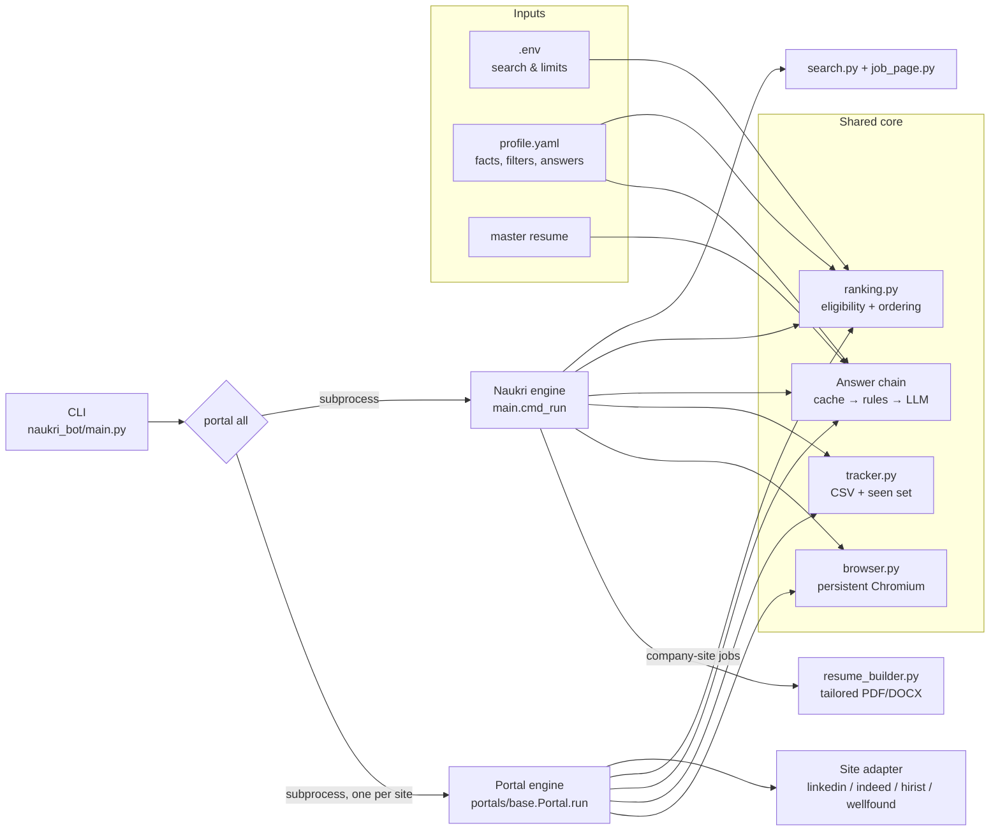
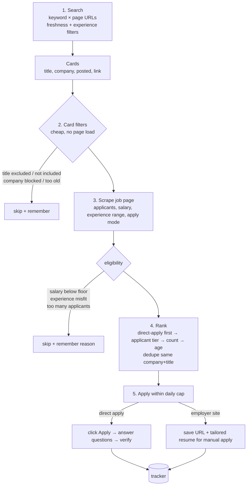
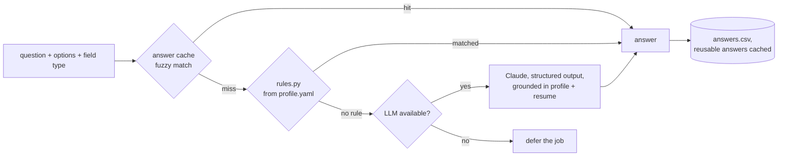

# Zangetsu

A job-application agent for Indian tech job portals and employer career sites. It finds fresh postings that match a candidate's profile, ranks them by how likely an application is to be seen, tailors a resume that stays within the candidate's real experience, and applies, answering screening questions from the candidate's own data and verifying every submission on the site.

Supported: **Naukri** (search, recommended jobs, recruiter invitations, profile refresh), **LinkedIn** Easy Apply, **Indeed**, **Hirist**, **Wellfound**, and employer career sites: **Workday** tenants, **Greenhouse / Lever / Ashby** boards, big-tech career APIs, and generic company application forms.

```
scripts/cycle.sh            # one full cycle: refresh, invitations, portals, top companies, career sites
python -m naukri_bot portal all
```

> **Use responsibly.** Automated applying is against the terms of service of most job portals and can get an account restricted. This project keeps volume deliberately low (per-site daily caps, human-paced delays, a real logged-in browser), never fabricates experience, and records every answer it gives so you can audit it. You are responsible for what is submitted in your name.

---

## Contents

1. [Design goals](#design-goals)
2. [Architecture](#architecture)
3. [The pipeline, stage by stage](#the-pipeline-stage-by-stage)
   - [The daily cycle and employer career sites](#the-daily-cycle-and-employer-career-sites)
4. [Answering screening questions](#answering-screening-questions)
5. [Portal adapters](#portal-adapters)
6. [State, data and outputs](#state-data-and-outputs)
7. [Setup](#setup)
8. [Configuration reference](#configuration-reference)
9. [CLI reference](#cli-reference)
10. [Operating it](#operating-it)
11. [Testing](#testing)
12. [Extending: adding a portal](#extending-adding-a-portal)
13. [Known limitations](#known-limitations)
14. [Troubleshooting and lessons learned](#troubleshooting-and-lessons-learned)

---

## Design goals

| Goal | How it is met |
|---|---|
| **Apply where it matters, not everywhere.** Volume is cheap; being early in a small applicant pool is what gets read. | A two-phase *survey → rank → apply* engine. Every posting is scraped and filtered first, then applied to in ascending order of applicant count. |
| **Never say something untrue about the candidate.** | All answers come from the candidate's profile, in a fixed order of trust: cached answer → deterministic rule → (optional) LLM. Tenure questions ("do you have 3–5 years?") are answered from real experience, not with a blanket yes. |
| **Survive site redesigns.** | Site specifics live in one adapter per portal; Naukri's DOM selectors live in a single `selectors.py`. The engine itself knows nothing about HTML. |
| **Look like a person, behave like a careful one.** | Headed Chromium with a persistent, manually logged-in profile; randomized delays; per-site daily caps; no parallel browsing. |
| **Every action is auditable and resumable.** | Each attempt, answer and skip reason is written to CSV/JSON. Processed jobs are never revisited; failed ones get exactly one retry. |
| **Works without any API key.** | The rule-based answerer covers the common question set; the LLM is an optional upgrade for open-ended questions and resume tailoring. |

## Architecture



**Two engines, one core.** Naukri was the first target and has the richest flow (a chatbot questionnaire drawer, company-site redirects, resume tailoring), so it has its own orchestration in `main.py`. Every other site plugs into a shared engine, `portals/base.Portal`, by implementing four methods. Both engines use the same ranking rules, answer chain, tracker and browser wrapper, so a filter or an answer rule changes behavior on every site at once.

**Process isolation.** `portal all` runs each site in its own subprocess with its own browser profile. A crash, CAPTCHA or logout on one site cannot take down the others, and each site keeps its own login.

### Module map

```
naukri_bot/
├── main.py            CLI; Naukri orchestration (survey → rank → apply), company-site handling
├── config.py          Settings from .env; profile/resume loaders
├── models.py          JobCard (search result), JobPosting (scraped detail), ApplyMode
├── search.py          Naukri search URLs and result-card parsing
├── job_page.py        Naukri job-page scraping; apply-mode detection
├── selectors.py       Every Naukri DOM selector, in one place
├── ranking.py         Eligibility rules, applicant tiers, sort order, survey cache
├── questionnaire.py   Naukri chatbot drawer driver (read question → answer → submit loop)
├── rules.py           Deterministic answers from profile.yaml
├── answers_store.py   Fuzzy cache of reusable question → answer pairs
├── llm.py             Optional Claude client: answers and tailored resumes (structured outputs)
├── resume_builder.py  Resume → Markdown / HTML / PDF (Chromium) / DOCX
├── naukri_profile.py  Pushes profile content (headline, skills, projects, ...) to Naukri
├── tracker.py         applications.csv, answers.csv, company_site_jobs.csv, seen_jobs.json
├── browser.py         Persistent headed Chromium, login detection, resilient clicks
├── humanize.py        Pauses, human-speed typing, reading-style scrolling
└── portals/
    ├── base.py        Portal interface + shared engine
    ├── runner.py      `portal <site|all>` glue, answerer factory
    ├── linkedin.py    Guest search endpoint + Easy Apply dialog
    ├── indeed.py      Date-sorted search + smartapply multi-step form
    ├── hirist.py      Keyword search + one-click apply with screening dialog
    └── wellfound.py   Role pages + apply dialog with cover note
profile/               Candidate data (*.example.* are templates; real files are gitignored)
templates/resume.html  Resume layout (Jinja2), printed to PDF by Chromium
tools/                 One-off helpers: per-portal manual login, LinkedIn profile export
tests/                 Offline tests against saved HTML fixtures
```

## The pipeline, stage by stage

Every portal goes through the same five stages. The diagram shows where a posting can drop out and why.



### 1. Search
Each site builds URLs from `KEYWORDS × PAGES_PER_KEYWORD`, with the site's native freshness and experience filters (Naukri `jobAge` / `experience`, LinkedIn `f_TPR` / `f_E` / `f_AL`, Indeed `fromage` / `sort=date`). Cards are de-duplicated across keywords by job id: "full stack developer" and "software engineer" return heavily overlapping sets.

### 2. Card filters
Cheap checks on the search card, before any page load:
- **Title include / exclude lists** (`profile.yaml`). Keywords of three characters or fewer (`ai`, `ml`, `sde`) match whole words only, so "ai" does not match "Mumb**ai**". Bare titles such as "Engineer" are rejected as uninformative.
- **Company blocklist**, e.g. firms that repost the same role dozens of times.
- **Age** against `MAX_JOB_AGE_DAYS`, with per-portal overrides for slower sites.

### 3. Scrape and eligibility
The job page is opened and parsed into a `JobPosting`. `ranking.eligibility()` then applies, in order: company, title, age, **salary floor**, **experience fit**, and **applicant cap**.

- **Salary.** A *disclosed* range is judged by its midpoint: with a 10 LPA floor, "6–10 Lacs" (realistically ~8) is skipped, "8–12" passes. Undisclosed salaries pass by default (`SKIP_UNDISCLOSED_SALARY=0`), because most postings hide salary.
- **Experience.** The candidate's years must fall inside the posting's range, widened by `EXPERIENCE_SLACK`.
- **Applicants.** Naukri shows exact counts below 50, then "50+" and "100+" (parsed as 51 and 101). Employer-site jobs are capped at `MAX_APPLICANTS`; direct-apply jobs use `MAX_APPLICANTS_DIRECT` (0 = no cap), since a direct application costs nothing.

Every skip is written to `seen_jobs.json` with its reason, so the next run neither re-scrapes the job nor wonders why it was dropped. The one exception is "too many applicants": it isn't remembered, because it can't be decided again later anyway.

### 4. Rank
Direct-apply jobs come before employer-site ones, then by applicant tier (`APPLICANT_TIERS`, e.g. `<50`, `50–100`, `100+`), then exact count, then age. Duplicate company + title pairs collapse to one.

### 5. Apply
Applications stop at the per-site daily cap (`min(adapter.daily_cap, DAILY_QUOTA)`) and are spaced by a random `MIN_DELAY`–`MAX_DELAY` seconds. Each `apply()` returns an `ApplyResult` with one of these statuses:

| status | meaning | retried next run? |
|---|---|---|
| `applied` | submitted and verified on the site | no |
| `applied_partial` | Naukri registered the application on the Apply click, but the questionnaire was not completed | no |
| `saved_for_manual` | employer-site job; URL (and tailored resume) saved | no |
| `deferred` | a question could not be answered safely without a model | yes |
| `failed` | technical failure before anything was sent (timeout, layout change, form still open) | once |
| `submitted_unconfirmed` | Submit was pressed but the site showed no confirmation | **no**: final, counts toward caps and the 30-day duplicate check, so it can never be sent twice |
| `crashed_after_submit` | `company-apply --submit` crashed mid-application | no (same reason) |
| `quota` | the site refused the application (Naukri's silent HTTP 403 past its cap) | yes, after the cooldown |
| `needs_you` / `ready_for_review` | an employer form has a field only the person can answer | yes, up to 3 times |

**Verification is mandatory.** A click is not an application. Naukri reloads the job page and checks the button state; LinkedIn waits for "Application submitted"; Indeed and Hirist check their applied markers. Unverified attempts are never recorded as `applied`.

**Refusals stop the run.** Past roughly 50 applications in a rolling 24 hours, Naukri's apply API answers HTTP 403 while the page still shows "Apply" and no message. The bot watches that response, stops at the first refusal, pauses Naukri for 12 hours (`state/cooldowns.json`), and leaves the job queued. Three unconfirmed applies in a row stop it too. Naukri's quota is counted over a rolling 24 hours (`DAILY_QUOTA`, default 45).

### Employer-site jobs (Naukri)
When a posting's button says "Apply on company site", the bot captures the redirect URL, writes the posting to `output/jd/`, and (with a model available) builds a resume tailored to that job description: reordered skills, rewritten bullets emphasizing the matching experience, with no invented facts. The output is `output/resumes/*.{pdf,docx,md}`, plus a row in `company_site_jobs.csv` with a keyword-fit score.

## The daily cycle and employer career sites

`scripts/cycle.sh` runs the whole job hunt as ordered stages; each one is also a command of its own:

| stage | command | what it does |
|---|---|---|
| 1. Profile refresh | `refresh` | Re-saves the Naukri resume headline (toggling a trailing full stop) so the profile shows *last updated: Today*. At most once per 3 hours; run it 2-3 times a day. |
| 2. Recruiter invitations | `nvites` | Reads Naukri NVites (`/mnjuser/inbox`), skips ones already applied, applies the normal filters, applies in-pane with the questionnaire handler. Invites that only link to an employer form are saved to `inputs/naukri-nvite-forms.txt`. |
| 3. Portals | `run`, `portal hirist` | Keyword search, recommended jobs, ranked by applicant count. |
| 4. Top companies on Naukri | `top-company-sites` | For each `priority_companies` entry (rotating, 12-15 per run), searches Naukri for *role at company* (`/software-engineer-jobs?k=software engineer, walmart`), keeps fitting postings that apply on the company site, and writes their employer links to `inputs/naukri-top-company-sites.txt`. |
| 5. Career sites | `workday-run`, `company-apply` | Workday tenants and Greenhouse/Lever/Ashby boards are surveyed directly; links from stages 2 and 4 are added. Each job gets a tailored resume, a keyword-coverage report, and the right form adapter. |

### Tailoring, grounding and the coverage score
Each employer job gets a resume built from `profile/resume_variants.yaml` (AI/ML, backend or full-stack variant chosen from the title and the JD's skills), with skills, bullets and projects re-ordered toward the JD. Optional per-job plans (`output/resumes/custom/*.json`) may re-word it further.

**Grounding check** (`grounding.py`): every skill item, the headline and the summary are checked against the candidate's facts (variants, profile skills, projects, education) plus an explicit table of honest relabels (MongoDB → "NoSQL", FAISS → "vector search", GitHub Actions → "CI/CD"). Anything not grounded is dropped and logged, and an ungrounded headline or summary falls back to the variant's own wording. Practices that can't be inferred from facts (Agile, system design, code reviews, ...) pass only if listed in `extra_skills_confirmed` in `profile.yaml`.

**Coverage score** (`ats_score.report`): the share of the JD's own hard-skill requirements (must-have vs nice-to-have when the JD has sections) that the resume covers, with the missing ones listed as real gaps. It is a keyword-coverage heuristic, not a vendor ATS score.

### Form adapters
| site | adapter | notes |
|---|---|---|
| Workday (`*.myworkdayjobs.com`) | `ats/workday.py` | account sign-in/creation, resume upload (always this job's file), experience and education pages, voluntary disclosures; submits only when every answer comes from trusted sources and no field is unknown |
| Greenhouse, Lever, Ashby, Keka, Zoho Recruit, plain career pages | `ats/generic_form.py` | label-driven: each field's label is matched to profile facts or the rule engine; unknown required fields stop the form |

Rules that apply to every employer form:
- **Never a guess.** Fields the bot can't answer from facts become `unknown` and the form goes to the person (`needs_you`). Dates of earlier jobs and education are never filled from a default.
- **Legal statements go to the person.** Only privacy, terms and data-processing acknowledgements are ticked automatically. Anything about work authorization, citizenship, sponsorship, criminal record, bonds, deposits, medical or relocation is left for the person.
- **Work authorization depends on the job's country.** It is answered only when the job is in the candidate's authorized country (`work_authorized_in`); "Indianapolis, IN" does not count as India.
- **Proof of submission.** A confirmation must be new after the click (not a "thank you for your interest" already on the page), or the URL must change to a success page, or the form must disappear. Otherwise the status is `unconfirmed`, which is final.
- **One tab per application.** Only the tab a click opened is used, and it is closed afterwards, so one company's form can never be submitted under another job.
- **Never twice.** `company-apply` and `workday` skip URLs already submitted or possibly submitted, and duplicates inside one input file.

## Answering screening questions

Screening questions are where automated applying usually goes wrong: either the bot skips them, or it says "yes" to everything. Here, answers resolve through a chain, cheapest and most trustworthy first:



**Rules (`rules.py`)** answer the questions that make up most real-world screening, straight from `profile.yaml`:

- **Notice period, availability, current/expected CTC.** These fill numeric fields with digits only, because portals reject "15 days" in a number box.
- **Years with a skill:** from the `skill_years` table, defaulting to `default_skill_years`.
- **"Do you have experience with X?":** yes, when `assume_skill_experience` is set.
- **"Do you have 3–5 years of total experience?":** answered from the candidate's real total, not blanket yes.
- **Relocation, location, work mode** (on-site, hybrid, remote; night and rotational shifts are declined), and interview history.
- **Contact details:** phone, country code, postal code, LinkedIn, GitHub and portfolio links.
- **Free-text answers:** from the `canned_answers` regex map.

**The cache (`answers_store.py`)** normalizes question text and fuzzy-matches it, so a question answered once on any portal is answered identically everywhere afterwards. Answers a site rejects are evicted.

**The LLM (`llm.py`, optional)** uses `claude-opus-5-5` through `client.beta.messages.parse` with Pydantic output schemas, so responses are typed objects rather than parsed text. Server-side refusal fallbacks are enabled. Without `ANTHROPIC_API_KEY`, or with `--no-llm`, questions no rule covers cause a *defer*, not a guess.

## Portal adapters

| Portal | Search | Apply flow | Daily cap | Notable quirks handled |
|---|---|---|---|---|
| **Naukri** | `/{keyword}-jobs-{page}?experience=&jobAge=` | Apply → optional chatbot drawer (radio, checkbox, chips, contenteditable text) | `DAILY_QUOTA` | Akamai blocks headless browsers (headed only); applicant counts cap at "100+"; the Apply click alone registers the application; the salary facet breaks keyword search (see Troubleshooting) |
| **LinkedIn** | Guest endpoint `jobs-guest/jobs/api/seeMoreJobPostings/search` with `f_TPR`, `f_AL=true`, `f_E=2,3,4`, `sortBy=DD` | Easy Apply native `<dialog>`: contact page, resume select/upload, screening pages, review, submit | 25 | Applicants shown as "Over N" / "Be among the first N"; radio groups exposed via ARIA roles; phone country-code selects; the button can render late (wait and retry) |
| **Indeed** | `in.indeed.com/jobs?q=&l=India&fromage=&sort=date` | "Easily apply" opens smartapply in a new tab; multi-step form | 40 | New-tab handling; job-alert opt-in unticked; questions pass through the same answer chain |
| **Hirist** | `/search/<keyword>?page=&exp=` | One-click Apply plus an optional screening dialog | 50 | No date sort, so a wider freshness window (`portal_max_age_days`); MUI selects need JavaScript clicks under a sticky footer |
| **Wellfound** | `/role/l/<role-slug>/india` | Apply dialog with a cover note (from `profile.yaml`) | 30 | Relocation checkbox dialog; "not accepting applications" detection; a disabled submit means deferral |

All adapters implement:

```python
class Portal:
    name: str; profile_dir: str; daily_cap: int
    def search_urls(self) -> list[str]: ...
    def collect_cards(self, url: str) -> list[JobCard]: ...
    def scrape(self, card: JobCard) -> tuple[JobPosting, ApplyMode]: ...
    def apply(self, job: JobPosting, mode: ApplyMode, answerer) -> ApplyResult: ...
```

## State, data and outputs

```
state/                       gitignored; contains live sessions and cookies
├── browser-profile/         Naukri Chromium profile (login persists)
├── <site>-profile/          one per portal
├── seen_jobs.json           {"<site>:<job_id>": "<reason or status>"}: never revisit
├── survey.json              scraped postings, reused for SURVEY_CACHE_HOURS
└── answer_cache.json        reusable question → answer pairs
output/                      gitignored
├── applications.csv         every attempt: time, portal, title, company, url, applicants, status, notes
├── answers.csv              every question asked and the answer given, with its source (cache/rules/llm)
├── company_site_jobs.csv    employer-site jobs to finish by hand, with resume paths and fit score
├── ranked_jobs.csv          the last run's eligible list, in apply order
├── resumes/  jd/  tailored/ generated resumes and saved job descriptions
└── *.log                    run logs
```

Nothing in `state/` or `output/` is committed. `answers.csv` exists so a human can audit, after the fact, exactly what was said on their behalf.

## Setup

Requirements: Python 3.11+, Chromium via Playwright, and a desktop session (the browser is headed).

```bash
python -m venv .venv && source .venv/bin/activate
pip install -r requirements.txt
playwright install chromium

cp .env.example .env                                    # search terms, limits, optional API key
cp profile/profile.example.yaml profile/profile.yaml    # facts the answers come from
cp profile/resume.example.md profile/resume.md          # grounding for the LLM (optional)
cp profile/master_resume.example.yaml profile/master_resume.yaml
cp profile/naukri_profile.example.yaml profile/naukri_profile.yaml   # only for `profile` command

python profile/build_master_resume.py    # builds the resume uploaded by Easy Apply forms
python -m naukri_bot login               # log in to Naukri once (OTP works)
python tools/linkedin_read.py            # one-time manual LinkedIn login (also exports your profile text)
python tools/portal_session.py indeed    # one-time manual login; same for hirist and wellfound
```

Logins persist in `state/`, so this is a one-time step until a site expires the session.

## Configuration reference

### `.env`: search and limits

| Variable | Default | Meaning |
|---|---|---|
| `KEYWORDS` | | Comma-separated search terms; one search per keyword per page |
| `LOCATION` | empty | Optional city; empty searches nationwide |
| `EXPERIENCE_YEARS` | | Candidate's years; used as the search filter and for fit |
| `EXPERIENCE_SLACK` | 1 | Years of tolerance on either side of a posting's range |
| `PAGES_PER_KEYWORD` | 2 | Result pages per keyword (20 cards each on Naukri) |
| `MAX_JOB_AGE_DAYS` | 1 | Freshness window (per-portal overrides in `profile.yaml`) |
| `MIN_SALARY_LPA` | 0 | Salary floor in lakh/year, judged on a disclosed range's midpoint |
| `SKIP_UNDISCLOSED_SALARY` | 0 | 1 = also skip postings that hide salary |
| `MAX_APPLICANTS` | 100 | Applicant cap for employer-site jobs |
| `MAX_APPLICANTS_DIRECT` | 0 | Applicant cap for direct-apply jobs (0 = none) |
| `APPLICANT_TIERS` | 50,100 | Ranking buckets |
| `DAILY_QUOTA` | 50 | Hard ceiling per site per day, counted from `applications.csv` |
| `MAX_APPLICATIONS` | 50 | Ceiling per run |
| `MAX_COMPANY_SITE_RESUMES` | 25 | Tailored resumes per run |
| `SURVEY_CACHE_HOURS` | 6 | Reuse scraped postings this long |
| `MIN_DELAY` / `MAX_DELAY` | 6 / 15 | Seconds between applications |
| `ANTHROPIC_API_KEY` | empty | Enables LLM answers and tailoring |
| `LLM_MODEL` | claude-opus-5-5 | Model for the above |

### `profile/profile.yaml`: who the candidate is

The single source of truth for every answer. Key groups (see `profile.example.yaml` for the full annotated template):

- **Identity and contact:** name, phone, email, location, postal code, links.
- **Career facts:** current title and company, `total_experience_years`, current and expected CTC, notice period.
- **Skills:** `skills`, `skill_years` table, `assume_skill_experience`, `default_skill_years`.
- **Filters:** `include_title_keywords`, `exclude_title_keywords`, `exclude_companies`, `portal_exclude_titles`, `portal_max_age_days`.
- **Free text:** `canned_answers` (regex → answer), `cover_note` (template with `{title}`/`{company}`), `resume_file`.

## CLI reference

```bash
python -m naukri_bot portal all                 # every site in sequence (the daily driver)
python -m naukri_bot portal linkedin --max 10   # one site, capped
python -m naukri_bot portal indeed --dry-run    # survey and rank only, no clicks

python -m naukri_bot run                        # Naukri only, with LLM if configured
python -m naukri_bot run --no-llm               # Naukri, rules only; uncovered questions defer
python -m naukri_bot run --survey-only          # write output/ranked_jobs.csv and stop
python -m naukri_bot run --only company         # only build resumes for employer-site jobs

python -m naukri_bot scrape <job-url>           # show what the parser extracts
python -m naukri_bot tailor <job-url>           # tailored resume for one posting
python -m naukri_bot ask "Notice period?" --options "Immediate,15 days,30 days"   # test the answer chain

python -m naukri_bot profile headline skills summary   # push profile sections to Naukri
python -m naukri_bot profile projects --new-only
python -m naukri_bot refresh                    # keep the Naukri profile "updated today" (3 h minimum gap)
python -m naukri_bot nvites [--dry-run]         # apply to recruiter invitations that pass the filters

python -m naukri_bot top-company-sites --companies 15     # priority companies' company-site jobs -> inputs/
python -m naukri_bot workday-run --days 3 --max 8 [--submit]   # Workday tenants: discover, tailor, fill
python -m naukri_bot workday <url> [--submit]             # one Workday application
python -m naukri_bot company-apply --file inputs/naukri-top-company-sites.txt [--submit] [--hold]
python -m naukri_bot leads                      # LinkedIn hiring posts -> leads CSV + outreach drafts (nothing sent)
```

Run inputs (URL lists, one-off scripts) live in `inputs/`, which is gitignored.

## Operating it

- **When to run.** Indian recruiters mostly post on weekday mornings, and applicant counts climb within hours. Running at about **11:00 and 17:00 IST, Tuesday to Thursday**, catches postings while they are still in the small-applicant tiers. A 3 AM run finds yesterday's postings already at 100+.
- **Watch the first run of the day.** A site may ask for a login or CAPTCHA; the browser is visible for exactly this reason. Solve it once and the session persists.
- **Read `answers.csv` weekly.** Every answer given is there with its source. If a rule answered badly, fix the rule or add a `canned_answers` entry; the cache is then corrected on the next rejection.
- **Finish `company_site_jobs.csv` by hand.** These are often the best roles: employers who run their own pipeline get fewer, more serious applicants.

## Testing

```bash
pytest -q
```

Tests run offline against saved HTML fixtures (`tests/fixtures/`) and cover search-card and job-page parsing, applicant-count and salary parsing, eligibility and ordering, the rule-based answerer (including tenure honesty and digits-only numerics), the questionnaire state machine, the tracker, and resume rendering. Live-site behavior can't be unit-tested; it is verified on every run by reading the applied state back from the site.

## Extending: adding a portal

1. Create `naukri_bot/portals/<site>.py` with a `Portal` subclass setting `name`, `profile_dir` and `daily_cap`.
2. Implement `search_urls` (use the site's native freshness filter and newest-first sort), `collect_cards`, `scrape` (return `ApplyMode.NAUKRI` for in-site apply, `COMPANY_SITE` for redirects), and `apply`.
3. In `apply`, route every question through the `answerer` you are given; never answer inline.
4. Verify submission from the site's own UI before returning `applied`.
5. Register it in `portals/runner.py` and the `portal` sub-command choices, and add a login entry to `tools/portal_session.py`.

Ranking, caps, delays, tracking and answer caching come for free.

## Known limitations

- **Selectors drift.** Job sites change markup often. Naukri's selectors are centralized; the other adapters keep theirs inline and need occasional updates. A layout change shows up as a spike of `failed` with timeouts.
- **Rule coverage is finite.** Without a model, unusual free-text questions defer the job. That is deliberate: a skipped application costs less than a wrong answer.
- **The LLM path is lightly exercised.** Production runs so far used the rule-based path (`--no-llm`); the Claude integration is implemented and unit-tested at the schema level but has had little live use.
- **Applicant counts are coarse** above 50 on Naukri and approximate on LinkedIn, so ranking inside the 100+ tier is by recency only.
- **One machine, one session.** A shared persistent profile per site means runs are sequential, not parallel. That is also safer.

## Troubleshooting and lessons learned

| Symptom | Cause | Fix |
|---|---|---|
| Every Naukri keyword returns the same ~16 unrelated jobs | Naukri's `ctcFilter` salary facet restricts results to postings with a disclosed salary and stops honoring the keyword | Salary is never filtered in the URL; it is checked per posting in `eligibility()` |
| "MIS Executive – Mumbai" passed the AI title filter | Substring match: "ai" in "Mumb**ai**" | Short keywords (≤3 chars) match whole words only |
| A 6–10 LPA job passed a 10 LPA floor | The range's top was compared with the floor | A disclosed range is judged by its midpoint |
| "Access Denied" on Naukri | Akamai bot protection rejects headless Chromium | Headed browser with a persistent, human-logged-in profile |
| LinkedIn says the number field is invalid | "15 days" typed into a numeric input | Numeric questions get digits only |
| LinkedIn "no Easy Apply button" on valid jobs | The button renders after the job panel | Wait and retry before declaring the job external |
| Login looks successful but nothing works | URL stayed on `/mnjuser/` while the login form was still rendered | Login is detected from the rendered page, not the URL |
| A site keeps failing one job forever | Retrying a broken posting every run | `failed` gets one retry; `deferred` is retried only when rules or a model can answer |
